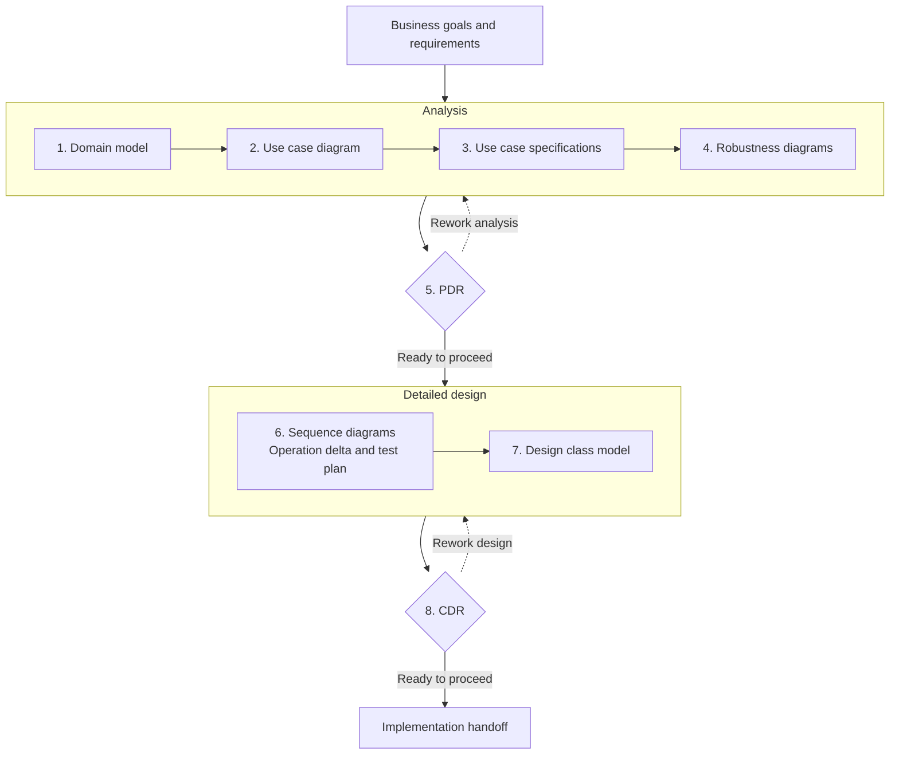

<!-- Copyright 2026 kingle.zhuang. See NOTICE for upstream attribution. -->
# MKL UML Skills

**Turn requirements into UML models, review the design, and trace it to tests.**

Eight agent skills guide you from business concepts to detailed design. Use one skill for a specific diagram, or work through all eight stages. Diagrams use PlantUML; specifications and review records use Markdown.

This guide follows one example throughout: **quote a shopping cart with an optional coupon**. The completed [order-pricing example](examples/order-pricing/README.md) includes requirements, diagrams, review findings, Python code and tests.

[Quick start](#quick-start) · [Run the finished example](#run-the-finished-example) · [Workflow](#workflow) · [Stage outputs](#stage-outputs) · [Documentation](#documentation)

## What does this help you do?

| When you need to… | Use the skills to… |
|---|---|
| Understand requirements before coding | Agree on business concepts, actors and user goals. |
| Work out success and failure behavior | Specify flows and show how responsibilities collaborate. |
| Explain a design | Connect class state and operations to requirements and interactions. |
| Keep documents and tests consistent | Review the links between artifacts and record gaps or corrections. |

<a id="how-to-use"></a>

## Quick start

### 1. Get the example and install the skills

Run in your **terminal**. This checkout supplies the example files used below:

```bash
git clone https://github.com/kinglez/mkl-uml.git
cd mkl-uml
```

Choose your agent; either command installs all eight skills into this project:

```bash
# Codex
npx skills@latest add kinglez/mkl-uml -a codex --skill '*' -y

# Claude Code
npx skills@latest add kinglez/mkl-uml -a claude-code --skill '*' -y
```

The Skills CLI needs Node.js 22.20+ and Git. Python 3.9+ runs the validators and executable example. To install into your own project, run the installation command there instead; the example files come from this checkout. See [installation options](docs/INSTALLATION.md).

### 2. Create the first model

Open this checkout in your agent. Paste the following into the **agent chat**:

```text
$mkl-uml-domain-modeler
Read examples/order-pricing/00-input/requirements.md and
examples/order-pricing/00-input/ACCEPTANCE_ORACLE.md.
Create a conceptual domain model for CU-01 Quote cart.
Save domain.puml and glossary.md under uml/order-pricing/01-domain/.
Explain the business concepts, relationships and unresolved assumptions.
Keep implementation services and discount strategies for detailed design.
Leave the completed examples/order-pricing reference files unchanged.
Run the applicable validator and report its actual result and limits.
```

For Claude Code, replace the first line with `/mkl-uml-domain-modeler`.

**Check the result:** your new folder contains `domain.puml` and `glossary.md`. The model explains concepts such as Cart, CartLine, Product, Coupon and PriceQuote. Compare it with the [completed domain model](examples/order-pricing/01-domain/domain.png).

### 3. Continue one stage at a time

Follow the **[eight-stage tutorial](docs/EXAMPLES.md)**. Each stage explains its purpose, names its inputs, gives a copyable prompt, and links to a completed result. It uses `uml/order-pricing/` for your work and leaves the published example available for comparison.

You can stop after the artifact you need. For your own project, replace the teaching requirements with your requirements and use your existing IDs.

<a id="complete-worked-example-order-pricing"></a>

## Run the finished example

You can inspect and execute the committed example before generating any models. From the repository root:

```bash
python3 examples/order-pricing/09-reference-implementation/run_example.py
python3 examples/order-pricing/scripts/verify.py
```

The cart contains two CNY 120.00 books and one CNY 15.00 pen: **CNY 255.00**. The demo prints these results, plus unknown and expired coupon refusals:

| Coupon | Discount | Payable |
|---|---:|---:|
| None | CNY 0.00 | CNY 255.00 |
| SAVE30 | CNY 30.00 | CNY 225.00 |
| TENOFF | CNY 25.50 | CNY 229.50 |
| BIGSAVE, capped at the subtotal | CNY 255.00 | CNY 0.00 |

JSON amounts are integer cents: `22500` means CNY 225.00. Quoting creates no order and leaves the inputs unchanged. No live service or Python dependency installation is needed.

The verifier checks the **committed reference example**, including its reviewed source baselines, validators, headers and tests. It does not check your newly generated `uml/order-pricing/` folder. A successful run ends with `Result: PASS`; its separate formal-acceptance status remains `NOT FULLY VERIFIED` because no human/business approval is claimed.

Read the **[guided example tour](examples/order-pricing/README.md)** to follow the results back to their requirements and diagrams. Pre-rendered images are included. Add `--render` to the verifier only if you have PlantUML installed and want to regenerate them.

## Workflow

The full workflow answers three questions: **What must the system do? How will it do it? Does the design agree with the requirements?**



**PDR (Preliminary Design Review)** checks the analysis before detailed design. **CDR (Critical Design Review)** checks the detailed design before implementation handoff. Each review records what was checked, findings, corrections and remaining gaps. The next stage reads that record and rechecks affected inputs when they change.

You can request a single artifact independently. Formal review is an explicit scope; automated checks alone establish neither formal approval nor SOLID conformance. See the [workflow guide](docs/MKL_METHODOLOGY.md) for the reasoning behind each stage.

<a id="what-each-stage-produces"></a>

## Stage outputs

These are **existing files** in the completed example. The tutorial creates corresponding working outputs under `uml/order-pricing/`.

```text
examples/order-pricing/
├── 00-input/
│   ├── requirements.md          Business rules and scope
│   └── ACCEPTANCE_ORACLE.md     Independently derived expected results
├── 01-domain/
│   ├── domain.puml              1. Business concepts and relationships
│   └── glossary.md
├── 02-use-cases/use-cases.puml   2. Shopper and CU-01 Quote cart
├── 03-spec/CU01-quote-cart.md    3. Success, alternative and exception flows
├── 04-robustness/
│   ├── robustness.puml          4. Boundary, control and entity analysis
│   └── correspondence.md
├── 05-pdr/PDR-01.md             5. Analysis findings and design handoff
├── 06-interactions/
│   ├── sequence.puml            6. Collaborations and guarded branches
│   ├── operation-delta.md          Operations allocated to their receivers
│   ├── test-plan.md                Observable expected behavior
│   └── DESIGN_DECISIONS.md
├── 07-class-model/
│   ├── classes.puml             7. Typed state, operations and relationships
│   ├── provenance.md               Why each member belongs in the design
│   └── SOLID.md                    Evidence and limits for design principles
├── 08-cdr/CDR-01.md             8. Detailed-design findings and readiness
└── 09-reference-implementation/ Additional executable code and tests
```

Implementation is a subsequent task; it is included here to make the teaching design testable. The [traceability guide](examples/order-pricing/TRACEABILITY.md) connects requirement IDs to behavior, design members and tests.

## Documentation

Start with the **[documentation reading guide](docs/README.md)**. Read only the material needed for your task:

| Your next task | Read |
|---|---|
| Follow the eight skills using order pricing | [Step-by-step tutorial](docs/EXAMPLES.md) |
| Inspect the already completed result | [Example tour](examples/order-pricing/README.md) |
| Choose another installation method | [Installation](docs/INSTALLATION.md) |
| Understand the workflow and review stages | [Workflow guide](docs/MKL_METHODOLOGY.md) |
| Look up input requirements, IDs or review states | [Operating contract](docs/OPERATING_CONTRACT.md) |
| Inspect actual checks, limits or version changes | [Validation record](docs/VALIDATION.md) · [Release notes](docs/RELEASE_NOTES.md) |

## Development and license

From the repository root, run `python3 -m unittest discover -s tests -v` for the regression suite or `python3 tools/package_skill.py` to build the per-skill archives. [Distribution details](docs/INSTALLATION.md#offline-skill-archives) explain the archive format.

**kingle.zhuang** · <kinglezhuang@vip.qq.com> · **mkl** · Copyright **2026**.

[Apache-2.0](LICENSE). [NOTICE](NOTICE) contains upstream attribution and project guidance. MKL is this edition's branding for the adapted workflow; [bibliography](docs/BIBLIOGRAPHY.md) and [source notes](docs/THIRD_PARTY_SOURCES.md) retain the original authors' attribution. This edition was translated and adapted with AI assistance; AI tools are not coauthors.
