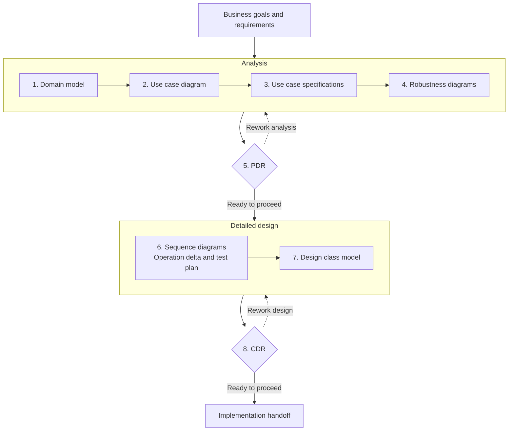

<!-- Copyright 2026 kingle.zhuang. See NOTICE for upstream attribution. -->
# MKL UML Skills

**Turn requirements into UML models you can trace, review and refine.**

Eight agent skills connect business vocabulary, user goals, behavior, design responsibilities and tests. Start with one artifact or explicitly request the complete MKL workflow. Models use PlantUML; specifications and review records use Markdown.

[Get started](#how-to-use) · [Workflow](#workflow) · [Stage outputs](#what-each-stage-produces) · [Complete worked example](#complete-worked-example-order-pricing) · [All eight prompts](docs/EXAMPLES.md)

## What problems does this solve?

| Problem | How the skills help |
|---|---|
| Requirements use inconsistent names or unclear concepts. | Build a shared domain vocabulary before choosing implementation classes. |
| User goals are mixed with internal processing steps. | Define actors, the system boundary and observable use case behavior. |
| Happy-path diagrams hide rejection and exception behavior. | Trace basic, alternative and exception flows through robustness, interactions and tests. |
| Design classes contain unexplained state or operations. | Record their domain, interaction, contract or design-decision origins. |
| Diagrams, specifications and tests drift apart. | Run PDR/CDR preparation checks and report located findings, missing evidence and required corrections. |

## Workflow

The complete workflow connects analysis to detailed design, with a review at each handoff.



**PDR** means Preliminary Design Review; **CDR** means Critical Design Review. Resolve findings that affect the next stage before proceeding. Missing applicable evidence remains **Not fully verified**; a formal disposition needs the designated decision maker. A clean validator result alone is not approval.

**Standalone work is the default.** You can create or review one diagram without completing every preceding stage. The diagram shows the explicitly requested full workflow.

## How to use

### 1. Install into your project

Use the [Skills CLI](https://github.com/vercel-labs/skills), with Node.js 22.20+ and Git. Python 3.9+ is needed to run the bundled validators. Run one command from your target project:

```bash
# Codex
npx skills@latest add kinglez/mkl-uml -a codex

# Claude Code
npx skills@latest add kinglez/mkl-uml -a claude-code
```

Choose skills when prompted. Add `--skill '*' -y` to select all eight, `--skill mkl-uml-domain-modeler` for one, or `-g` for personal installation. For pinned versions, offline packages, Windows and other hosts, see [Installation](docs/INSTALLATION.md).

### 2. Give the agent a concrete request

Open your project in Codex or Claude Code. Paste this into the **agent chat**, not your terminal:

```text
$mkl-uml-domain-modeler
Create a conceptual PlantUML domain model for a technical support desk.
- RF-01: A Requester registers an Incident with a Category and description.
- RF-02: Its due date comes from the Category's current ServiceAgreement.
- RF-03: Reject requesters who are not authorized for the Category.
- RNF-01: Deadline policy can change independently of the Incident.
An Incident has a description, registration date, due date and business reference.
Save the requirements to uml/requirements.md and the model to uml/domain.puml.
Explain assumptions and unresolved questions. Keep implementation classes
out of this conceptual view.
```

In Claude Code, use `/mkl-uml-domain-modeler` in place of `$mkl-uml-domain-modeler`. Expected result: `uml/requirements.md` and a domain model containing `Requester`, `Incident`, `Category` and `ServiceAgreement`. Request SVG/PNG as well if you want rendered diagrams and a renderer is available.

### 3. Continue from the files you have

Use the [eight copyable stage prompts](docs/EXAMPLES.md) for the workflow above. Each prompt names its inputs and output paths. Run a stage when its inputs exist; review findings and correct affected artifacts before the next handoff.

For an existing diagram, invoke only the relevant skill:

```text
$mkl-uml-sequence-diagram
Review uml/sequence.puml against uml/register-incident.md.
Check operation calls, replies, missing branches and activation balance.
Apply supported corrections, preserve CU/DS/FA IDs, and report the checks
actually run and any missing comparison evidence.
```

Replace these example paths with your files or attach the artifacts. Installation copies the skills; it does not generate project outputs automatically.

### 4. Inspect the artifacts and verification coverage

Read the generated PlantUML/Markdown and the reported findings. Ask the agent to run the relevant bundled validator and recheck corrections. Keep unresolved assumptions, missing inputs and human decisions visible. For formal review, request that scope explicitly and supply its applicable evidence.

## What each stage produces

These are **illustrative project outputs**, using the same flat paths as [the stage prompts](docs/EXAMPLES.md). They are created only when requested; the installation does not create this tree. A stage may update an existing artifact rather than create another copy.

```text
uml/
├── requirements.md          # Input: goals, RF/RNF requirements and constraints
├── domain.puml              # 1: conceptual domain model
├── use-cases.puml           # 2: actors, system boundary and user goals
├── register-incident.md     # 3: CU-07 basic and alternative flows
├── robustness.puml          # 4: DR-07 boundary/control/entity analysis
├── pdr-review.md            # 5: findings, coverage, decisions and rework
├── sequence.puml            # 6: DS-07 interactions and guarded branches
├── operation-delta.md       # 6: receiver/operation/source mappings
├── test-plan.md             # 6: derived success and rejection tests
├── classes.puml             # 7: MC-07 typed design classes and relationships
└── cdr-review.md            # 8: detailed-design findings and handoff readiness
```

CDR can also generate inspection headers when requested. Those are review aids; production implementation is a subsequent task.

| Stage | Skill | Main question answered |
|---|---|---|
| 1 | [mkl-uml-domain-modeler](skills/mkl-uml-domain-modeler/README.md) | What concepts and relationships exist in this domain? |
| 2 | [mkl-uml-use-case-diagram](skills/mkl-uml-use-case-diagram/README.md) | Who uses the system, and for which goals? |
| 3 | [mkl-use-case-specifier](skills/mkl-use-case-specifier/README.md) | What does the actor/system do on each flow? |
| 4 | [mkl-uml-robustness-diagram](skills/mkl-uml-robustness-diagram/README.md) | Which interfaces, controls and entities realize that behavior? |
| 5 | [mkl-pdr-review](skills/mkl-pdr-review/README.md) | Is the analysis consistent enough to proceed to detailed design? |
| 6 | [mkl-uml-sequence-diagram](skills/mkl-uml-sequence-diagram/README.md) | Which participants collaborate, and which operations/tests follow? |
| 7 | [mkl-uml-design-class-model](skills/mkl-uml-design-class-model/README.md) | Where do typed state, operations and relationships belong? |
| 8 | [mkl-cdr-review](skills/mkl-cdr-review/README.md) | Is the detailed design consistent enough for implementation handoff? |

## Complete worked example: order pricing

Explore the **[order-pricing reference example](examples/order-pricing/README.md)** to see all eight stages applied to one problem, including PDR/CDR findings, corrected models, executable Python code and tests. The example is fully in English and includes six rendered UML diagrams, 17 design classifiers and 30 independent acceptance cases.

| Start here | What you can inspect |
|---|---|
| [Example guide](examples/order-pricing/README.md) | Business rules, expected prices, workflow, stage outputs and run commands. |
| [Eight replay prompts](examples/order-pricing/HOW_TO_REPLAY.md) | Recreate the example with the eight skills, including explicit PDR-to-design handoff. |
| [Traceability](examples/order-pricing/TRACEABILITY.md) | Follow a requirement through use case behavior, interactions, class members and tests. |
| [Change and correction history](examples/order-pricing/CHANGE_IMPACT.md) | Review actual modeling corrections and add a discount policy without editing the core workflow. |
| [Verification record](examples/order-pricing/VALIDATION.json) | Reproducible checks and their actual results, with formal acceptance kept separate. |

From a checkout of this repository:

```bash
python3 examples/order-pricing/09-reference-implementation/run_example.py
python3 examples/order-pricing/scripts/verify.py
```

Python's standard library is sufficient for these commands. Add `--render` to verification to regenerate SVG/PNG with a local PlantUML installation. The example is part of the GitHub repository; installing the skills does not copy these project artifacts into your application. [Browse the complete example on GitHub](https://github.com/kinglez/mkl-uml/tree/main/examples/order-pricing).

## Example: register an incident

The quick-start request above is illustrated by the smaller pipeline fixtures for **CU-07 Register incident**.

- **Success:** an authorized Requester submits an existing Category; the system obtains its current ServiceAgreement, calculates the due date, registers the Incident and returns its identifier and due date.
- **FA-01:** an unauthorized Requester receives a refusal; no Incident is created.
- **FA-02:** an unknown Category produces a refusal; no Incident is created.
- **Design decision:** `DeadlinePolicy` is introduced during detailed design to satisfy RNF-01. It is a solution class, distinct from the conceptual domain vocabulary.

Inspect the **existing files** below to see actual inputs and modeled outputs. Their legacy filenames are retained for validator compatibility; the contents are English.

| Stage / evidence | Existing worked artifact |
|---|---|
| Input | [Requirements](tests/fixtures/pipeline/requisitos.md) |
| 1 | [Domain model](tests/fixtures/pipeline/dominio.puml) |
| 2 | [Actors and use cases](tests/fixtures/pipeline/casos_uso.puml) |
| 3 | [CU-07 specification](tests/fixtures/pipeline/especificacion.md) |
| 4 | [DR-07 robustness](tests/fixtures/pipeline/robustez.puml) |
| 6 | [DS-07 sequence](tests/fixtures/pipeline/secuencia.puml) and [test plan](tests/fixtures/pipeline/plan_pruebas.md) |
| 7 | [MC-07 design classes](tests/fixtures/pipeline/modelo_clases_diseno.puml) |

PDR/CDR records are requested outputs, as shown in the tree; this fixture set does not contain signed review records. Fixtures demonstrate the supported modeling/checking profile. Use [the example prompts](docs/EXAMPLES.md) to produce your own artifacts and review records.

## Documentation

- [Operating contract](docs/OPERATING_CONTRACT.md): modes, inputs, coverage and stable IDs.
- [Usage examples](docs/EXAMPLES.md): copyable prompts for all eight skills.
- [MKL methodology](docs/MKL_METHODOLOGY.md): the complete design workflow.
- [Installation](docs/INSTALLATION.md): host-specific and offline installation.
- [Validation record](docs/VALIDATION.md): executed checks and known limits.
- [Bibliography](docs/BIBLIOGRAPHY.md) and [third-party sources](docs/THIRD_PARTY_SOURCES.md): attribution and source dispositions.
- [Release notes](docs/RELEASE_NOTES.md): versions and distribution boundaries.

MKL is this edition's branding for an adapted use-case-driven workflow. Original literature remains attributed to its authors. Instructions and outputs are English by default; request another output language when needed.

## Development and distribution

From this repository root:

```bash
python3 -m unittest discover -s tests -v
python3 tools/package_skill.py
```

The `.skill` suffix is a packaging convention; use the [host-specific installation guide](docs/INSTALLATION.md). Validators check supported profiles and heuristics; passing does not establish complete UML semantics or formal human acceptance.

## Author and license

**kingle.zhuang** · <kinglezhuang@vip.qq.com> · **mkl** · Copyright **2026**.

[Apache-2.0](LICENSE). [Project information](NOTICE) includes upstream attribution, contribution and community conduct. This edition was translated and adapted with AI assistance; AI tools are not coauthors.
