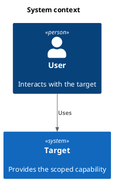

<!-- Copyright 2026 kingle.zhuang. Licensed under Apache-2.0. -->
# C4 architecture: from analysis to detailed design

Use `mkl-uml-c4-architecture` for the high-level choices that sit between understood
requirements and detailed classes/interactions. It uses [C4-PlantUML](https://github.com/plantuml-stdlib/C4-PlantUML)
through PlantUML's bundled standard library. The primary method reference is
[the official C4 model](https://c4model.com/): **system context → containers → components → code**. It is independently usable; it does not
require a full UML workflow or a PRD.

## What comes in, and what goes out?

| Stage | Actual input | Output consumed next |
|---|---|---|
| Establish design drivers | Any supplied conversation, ticket, document, image, contract or current-system evidence; available analysis/PDR | Confirmed functions, relevant quality scenarios, source versions, assumptions and open choices |
| Choose architecture | Those drivers and existing architecture | Selected C4 views, ownership/dependencies, decisions, alternatives and costs |
| Check the architecture | Current drivers, decisions and actual C4 sources | Mechanical findings, local rendering evidence, semantic findings and corrected handoff |
| Detailed design | Current architecture handoff and use-case behavior | Module/interface contracts, sequence/class models, state behavior where applicable and tests |
| CDR | Architecture and detailed-design evidence | Explicit correspondence findings, verified corrections and remaining blockers |

A requirement change makes affected decisions and downstream outputs subject to recheck.
Missing architecture-changing answers block dependent choices; independent work can continue.
The existing CDR validator does not parse C4: label architecture correspondence as a separate
semantic review, with the actual inputs and findings.

## Ask about behavior and quality

Functional questions cover actors/goals, normal/alternative/failure paths, authoritative
data and system/external boundaries. Quality questions cover relevant performance/capacity,
availability/recovery, consistency, security/privacy, observability, maintainability,
compatibility, deployment and cost. Do not ask every question for every task.

An important quality becomes a scenario: under what context/load, which stimulus, what
response, which observable criterion, and how will it be verified? Reuse agreed targets.
An unknown target stays open; a diagram cannot establish actual performance or recovery.
[Question guidance](../skills/mkl-uml-c4-architecture/references/quality-and-decisions.md).

## Choose the views

| View | Use when asking… | Shows |
|---|---|---|
| Context | Where does the target end, and who uses/integrates with it? | People, target and neighboring systems |
| Container | Which applications and stores realize the system? | Responsibilities, technologies, communication and data authority |
| Component | How is one selected container organized internally? | Components, responsibilities and dependencies within that scope |
| Code | How is one selected component implemented? | Relevant UML classes/interfaces, functions or data structures |
| Deployment (supporting) | Where do runtime units run, and which failure boundaries matter? | Environment/nodes, deployed units and connections |

Context/container usually suffice for a system overview. Components and deployment are
selected for a concrete question. Deployment is a supporting diagram, not the fourth C4
abstraction level. Code is the fourth static level, scoped to one component. Use
`mkl-uml-design-class-model` for its static code view, preserving component-to-code
mapping. Add `mkl-uml-sequence-diagram` for behavior. These views are optional; prefer
source-derived/tool-generated detail for existing code and label proposed design.
A C4 container is an application or data store, not necessarily Docker.
Do not turn BCE controls directly into services. Do not invent a host system for a small
library task; reuse a checked host architecture or explain the limited scope.

## Drawing and checking

Each C4 macro view uses its matching bundled include, for example. The code view
uses ordinary UML and has no required C4_Code include:



The package's [four neutral source fixtures](../skills/mkl-uml-c4-architecture/tests/fixtures/)
exercise the literal protocol without encoding an application business domain.
Use the installed skill's script from its own directory:

```bash
python3 scripts/validate_c4.py path/to/context.puml --level context
plantuml -tsvg path/to/context.puml
```

Replace paths with your actual sources. Rendering requires a local PlantUML runtime with
C4 standard-library support and its applicable layout dependencies; installation of a skill
does not install that runtime. Record the PlantUML/library version with reproducible results.
Remote rendering requires authorization appropriate to the supplied source material.

| Check | Establishes | Does not establish |
|---|---|---|
| Literal CLI (C4 macros; code UML uses its own checker) | Supported elements, levels, references and declared ownership/consistency | Full PlantUML semantics or a good architecture |
| Local rendering | Syntax accepted by that runtime and an inspectable preview | Correct requirements or achieved quality |
| Semantic review | Examined boundaries, alternatives, traceability and detailed-design correspondence | Unexecuted tests or formal human acceptance |
| Runtime verification | Measured behavior under the executed scenario | Guarantees outside the tested scenario |

## Handoff artifacts

Use the project's existing organization. This is an output layout example, not a fixed
input contract or a list of compulsory views:

```text
architecture/
├── architecture-brief.md       Sources, scope, qualities, choices and next consumer
├── context.puml                Selected editable C4 views
├── container.puml
├── component.puml              When a container needs internal design
├── deployment.puml             When runtime placement matters
├── code.puml                   Optional scoped UML view of a component
├── component-code-map.md        Parent component → relevant code elements
├── previews/                   Actual local render outputs when available
└── architecture.json           Optional machine-readable record
```

The [brief template](../skills/mkl-uml-c4-architecture/assets/architecture-brief.md) can be
replaced by equivalent existing documentation. The optional [record template](../skills/mkl-uml-c4-architecture/assets/architecture-record.json)
records source → requirement → decision → view links. Requirements may originate in any
medium; JSON is an internal handoff option. The [validation profile](../skills/mkl-uml-c4-architecture/references/validation-profile.md)
defines the precise checked subset and limitations.

At detailed design, map responsibilities to modules, interfaces and operation ownership;
map declared communications to sequences and relevant failure behavior; map quality
strategies to constraints and verifiable tests. A C4 component does not imply a class of
the same name. Keep missing evidence and architecture-changing choices visible.

The [order-pricing tutorial](EXAMPLES.md#6-c4-architecture) now includes a dated
[architecture replay](../examples/order-pricing/architecture/README.md). Its frozen
requirements and current code are compared with all four C4 zoom levels. No new
deployment, SLA or write lifecycle is invented. The replay records executed checks
and reinspection separately from historical reviews and formal acceptance.
