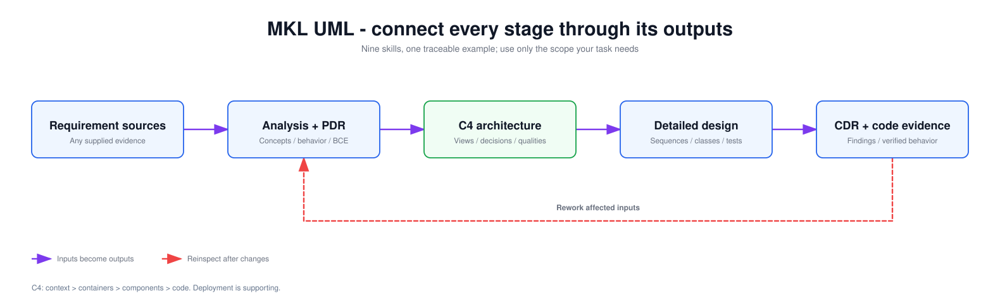

<!-- Copyright 2026 kingle.zhuang. See NOTICE for upstream attribution. -->
# How the workflow fits together

The progression is **understand the behavior → choose the architecture → design the
collaboration and contracts → review the result**. Use the stages your task needs.

## One problem, nine questions

| Stage / skill | Question it answers | Output used next |
|---|---|---|
| Domain model | What do the business terms mean? | Concepts, relationships and glossary |
| Use case diagram | Who wants what from the system? | Actors, boundary and goals |
| Use case specification | What happens in success, alternatives and failure? | Rules, flows and acceptance criteria |
| Robustness analysis | Which interface, responsibility and business state realize each flow? | Boundary/control/entity model |
| PDR: Preliminary Design Review | Does the analysis agree? | Findings, corrections and remaining constraints |
| C4 architecture | Which applications, data stores and dependencies fit the requirements? | Views, ownership and design decisions |
| Sequence design | Who calls whom to realize the behavior? | Interactions, operation allocation and test cases |
| Class design | Where do state, operations and dependencies belong? | Typed class/interface contracts |
| CDR: Critical Design Review | Do the detailed models and behavior agree? | Findings and implementation-handoff notes |

Robustness is an **analysis** model: boundary means an interaction interface, control
means a coordinating responsibility, and entity means business information.
It is not a list of implementation services. Architecture chooses broader boundaries;
sequence and class design then work out contracts inside them.

## Why the two reviews matter

PDR catches missing behavior, terminology conflicts and misplaced responsibilities
before detailed design. CDR checks the resulting interactions, signatures and contracts
against the requirements, architecture and available test evidence.

For either review: locate the problem → correct its owning artifact → recheck the
affected relationships. A technical recommendation is separate from formal approval.

## How outputs connect

Each stage reads the current relevant outputs from the preceding work. Keep explicit
links from a requirement to its behavior, responsible model elements and tests.
When a requirement or design decision changes, re-examine the affected downstream work.
Preserve the identity of unchanged items.

A standalone architecture or diagram can start directly from supplied requirements.
Unknown policy or quality targets remain questions; do not fill them with invented
decisions. Full workflow handoffs carry the reviewed scope, findings and constraints.

Try the **[worked tutorial](EXAMPLES.md)** to see the connections in one scenario.
For a single task, use the **[skill selector](STANDALONE.md)**.
Exact handoff rules are in the [operating contract](OPERATING_CONTRACT.md); methodological
sources remain in the [bibliography](BIBLIOGRAPHY.md).
