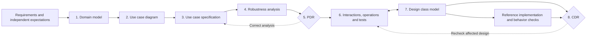
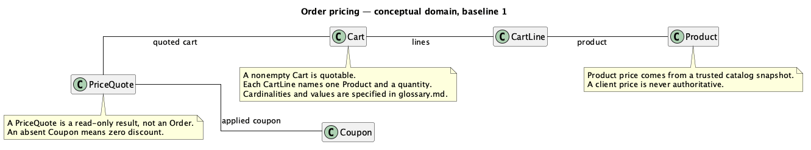
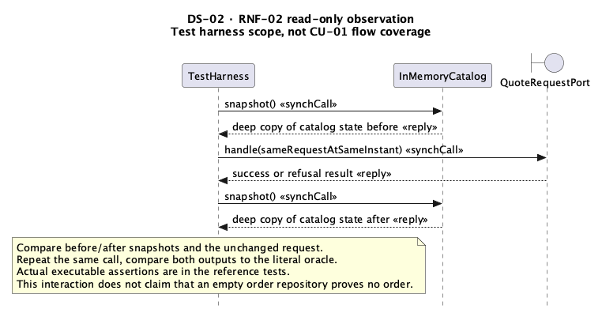

# Order pricing: a complete MKL UML reference example

Follow **CU-01 Quote cart** from business requirements through all eight MKL UML stages, then run a small reference implementation to challenge the design. The example includes six maintained UML diagrams, 17 design classifiers, review findings and corrections, independent expected results, and executable tests.

[Run the example](#run-the-example) · [Eight-stage artifacts](#eight-stage-artifacts) · [Replay the skills](HOW_TO_REPLAY.md) · [Trace a rule](TRACEABILITY.md) · [Review the changes](CHANGE_IMPACT.md)

## Run the example

Clone the repository and run these commands from its root:

```bash
git clone https://github.com/kinglez/mkl-uml.git
cd mkl-uml
python3 examples/order-pricing/09-reference-implementation/run_example.py
python3 examples/order-pricing/scripts/verify.py
```

The reference implementation uses Python 3.9+ and the standard library. No package installation, account or live service is needed. The verification entry point runs the skill validators, checks the reviewed source baselines, compares generated inspection headers, and executes the reference tests and examples.

Pre-rendered PNG and SVG diagrams are included for reading on GitHub. To regenerate them with a local PlantUML installation:

```bash
python3 examples/order-pricing/scripts/verify.py --render
python3 examples/order-pricing/scripts/build_viewer.py
```

Open `examples/order-pricing/index.html` from the local checkout for the tabbed offline reader. GitHub readers can use the Markdown links and images below. The [published validation record](VALIDATION.json) identifies checks run for this publication; a local rerun writes fresh logs under `validation/latest/`.

## Business scenario and expected results

A Shopper supplies Product codes, quantities and at most one Coupon code. Order Pricing obtains authoritative prices from a trusted internal catalog and returns the item subtotal, discount and payable item amount, or an explicit refusal. Quoting leaves the cart, catalog and Coupon state unchanged and creates no Order.

The main cart contains two books priced at CNY 120.00 each and a pen priced at CNY 15.00: **CNY 255.00** in total. All monetary calculations use integer cents.

| Scenario | Discount, CNY | Payable, CNY |
|---|---:|---:|
| No Coupon | 0.00 | 255.00 |
| SAVE30: spend at least 200.00, receive 30.00 off | 30.00 | 225.00 |
| TENOFF: spend at least 100.00, receive 10% off | 25.50 | 229.50 |
| BIGSAVE: 500.00 off, capped at the subtotal | 255.00 | 0.00 |
| Separate eligible 10% scenario: subtotal 3.33, Coupon minimum 0 | 0.33, rounded down to a cent | 3.00 |
| Below minimum, expired/unknown Coupon, unknown Product or invalid quantity | Explicit refusal | No successful quote |

The [requirements](00-input/requirements.md) define the fictional baseline and its scope. An independent AI contributor derived the [30 acceptance scenarios](00-input/ACCEPTANCE_ORACLE.md) and their [literal expected results](00-input/acceptance-oracle.json) before reading the implementation. The tests consume those expectations rather than calculating expected amounts with production logic.

## Eight-stage artifacts



PDR means **Preliminary Design Review**; CDR means **Critical Design Review**. PDR was completed before detailed design. The reference implementation supplies additional feasibility and behavior evidence for CDR; it does not replace cross-artifact review.

| Stage | Readable artifacts | Diagram preview |
|---|---|---|
| Input | [Requirements](00-input/requirements.md), [acceptance oracle](00-input/ACCEPTANCE_ORACLE.md) | — |
| 1. Domain | [PlantUML](01-domain/domain.puml), [glossary](01-domain/glossary.md) | [PNG](01-domain/domain.png) · [SVG](01-domain/domain.svg) |
| 2. Use cases | [PlantUML](02-use-cases/use-cases.puml), [actor/goal mapping](02-use-cases/actor-goal-map.md) | [PNG](02-use-cases/use-cases.png) · [SVG](02-use-cases/use-cases.svg) |
| 3. Specification | [CU-01](03-spec/CU01-quote-cart.md), [interface contract](03-spec/interface-contract.md) | — |
| 4. Robustness | [PlantUML](04-robustness/robustness.puml), [behavior/data correspondence](04-robustness/correspondence.md) | [PNG](04-robustness/robustness.png) · [SVG](04-robustness/robustness.svg) |
| 5. PDR | [Findings and independent reinspection](05-pdr/PDR-01.md), [correction details](03-spec/pdr-corrections.md) | — |
| 6. Interactions | [DS-01](06-interactions/sequence.puml), [DS-02 observation protocol](06-interactions/contract-observation.puml), [operation allocation](06-interactions/operation-delta.md), [test plan](06-interactions/test-plan.md), [design decisions](06-interactions/DESIGN_DECISIONS.md) | [DS-01 PNG](06-interactions/sequence.png) · [DS-01 SVG](06-interactions/sequence.svg) · [DS-02 PNG](06-interactions/contract-observation.png) |
| 7. Design classes | [MC-01](07-class-model/classes.puml), [member provenance](07-class-model/provenance.md), [SOLID evidence](07-class-model/SOLID.md) | [PNG](07-class-model/classes.png) · [SVG](07-class-model/classes.svg) |
| 8. CDR | [Independent review](08-cdr/CDR-01.md), [inspection headers](08-cdr/headers.java), [header inspection](08-cdr/header-inspection.md), [code audit](08-cdr/CODE-AUDIT-01.md) | — |
| Executable evidence | [Reference implementation](09-reference-implementation/README.md), [tests](09-reference-implementation/tests/test_pricing.py), [extension exercise](09-reference-implementation/extension_demo.py) | — |

### Conceptual domain



### Technical observation protocol

DS-02 makes the before/after state observations explicit. It is an RNF-02 test protocol, not another Shopper goal and not a substitute for DS-01's business-flow coverage.



The full [sequence](06-interactions/sequence.svg), [robustness](04-robustness/robustness.svg) and [class model](07-class-model/classes.svg) are larger diagrams; open their SVGs to inspect them at full resolution.

```text
order-pricing/
├── 00-input/                    Requirements and independent acceptance oracle
├── 01-domain/                   Conceptual model and glossary
├── 02-use-cases/                System boundary, actor and CU-01
├── 03-spec/                     Basic/alternative/exception flows and interface contract
├── 04-robustness/               BCE analysis and behavior/data correspondence
├── 05-pdr/                      Analysis review, findings and reinspection
├── 06-interactions/             DS-01, DS-02, operation delta, test plan and decisions
├── 07-class-model/              Typed design, provenance and SOLID evidence
├── 08-cdr/                      Detailed-design review and declaration inspection
├── 09-reference-implementation/ Python example, extension and behavioral tests
├── handoffs/                    Reviewed publication-source baselines
├── review-history/              Normalized illustrations of earlier defects
├── scripts/                     Verification and offline-reader generation
├── HOW_TO_REPLAY.md              Copyable prompts for all eight skills
├── TRACEABILITY.md               Requirements → behavior → members → expected results
├── CHANGE_IMPACT.md              Actual corrections and controlled extension
├── WORKFLOW_REVIEW.md            Workflow assessment and evidence limits
├── VALIDATION.json               Published validation summary
└── index.html                    Offline reading entry point
```

## What the reviews actually caught

The process found issues that a clean validator result alone did not establish:

- **Unsupported business policy:** analysis had invented a requirement to reject a negative Coupon minimum. PDR removed that mandate and retained the unresolved policy outside the verified baseline.
- **Incorrect termination semantics:** an early sequence nested `break` inside other fragments. Later review also found frames that did not cover every lifeline. The maintained interaction has top-level, full-span refusal breaks and successful completion only after every check.
- **Inconsistent multiplicity:** a source-end multiplicity of `1` contradicted shared immutable CartLine values. CDR corrected it to `0..*` and checked the resulting declarations.

The [change record](CHANGE_IMPACT.md) shows affected artifacts, retained IDs and reinspection. Former explicit creation-message identity **DS-01-M10 is retired**; PriceQuote construction remains an internal completion action and returned value, rather than an invented ordinary operation.

## SOLID and verification boundaries

The [SOLID record](07-class-model/SOLID.md) examines responsibilities, extension scope, common behavior, actual client capabilities and source dependencies. The extension adds a capped-half strategy through registration and produces a CNY 235.00 payable amount for the main cart. Shared contract cases check the same accepted input domain, integer bounds, determinism and unchanged policy state. These finite examples support the declared design choices; they do not prove universal OCP/LSP conformance.

The original local exercise passed 16 aggregate checks, including rendering, and 15 unittest methods containing 30 independent baseline cases plus additional contract/adapter checks. Reference tests were actually run on Python 3.9.6 and 3.14.7. Use [VALIDATION.json](VALIDATION.json) for the publication's recorded execution and rerun the commands above for your checkout.

This English publication edition adapts the locally reviewed teaching materials for portable repository use. Business semantics, stable identities and expected monetary outcomes are retained; editorial text, paths and publication baselines have changed. The historical review notes describe real AI technical review and corrections, rather than claiming that the adapted files have the old byte hashes. Machine-specific raw logs are omitted; fresh runs produce local evidence.

The [publication review](PUBLICATION_REVIEW.md) checks this English repository edition. [Origin and adaptation notes](ORIGIN.json) identify the unchanged requirements, oracle and business core, plus explicit UTF-8 I/O adjustments in the example/test entry points. Text checksums normalize LF/CRLF so Git checkout line endings do not invalidate an otherwise identical baseline.

The technical PDR/CDR conclusion is **Ready for this bounded teaching example**. Formal human/customer/business acceptance remains **Not fully verified**. Inspection headers are review aids, not executable Java implementations. Authentication, production time authority, tax/shipping, payment, persistence, concurrency and fault recovery are outside this example; projects with those concerns need their corresponding design and verification evidence.
