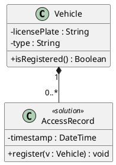

<!-- English-edition adaptation: Copyright 2026 kingle.zhuang. See NOTICE for upstream attribution. -->
# Design model notation

What to draw, omit, and why. Where sources disagree, state the disagreement and the position this skill follows.

**Fowler quotation notice.** The *UML Distilled* corpus file has **systematic OCR corruption**: `dass`→class, `an`→on, `lt`→it, `1`→I, `irrmutable`→immutable, among others. Quotations here are **normalized to the correct wording**, as printed in the book. This disclosure explains discrepancies with the corpus file. The other three corpus books are clean.

---

## What distinguishes this model from the domain model

| | Domain model (`/mkl-uml-domain-modeler`) | Design class model (this skill) |
|---|---|---|
| Fowler perspective | **Conceptual** | **Software** (specification/implementation) |
| Operations | Prohibited (`hide methods`) | **Primary contribution** |
| Attribute types | Prohibited in strict mode | **Present** |
| Visibility | Prohibited | **Present** |
| Multiplicities | Only if the rubric requires them | Useful, not mandatory |
| Navigability | Absent | Present where relevant |
| Infrastructure classes | Prohibited | **Present and marked** |
| Inheritance | Conceptual (domain *is-a*) | Conceptual **plus** discoveries made during design |

Fowler states the distinction twice in chapter 3:

> *"In conceptual models, navigability isn't an important issue, so I don't show any navigability arrows on conceptual models."*

> *"With conceptual models, you shouldn't use operations to specify the interface of a class."*

Chapter 1 frames the conceptual perspective as *"represents a description of the concepts of a domain of study"*, whereas in the software perspective *"the elements of the UML map pretty directly to elements in a software system"*. **Edition notice:** the third edition merged specification and implementation into one software perspective—*"I found that it was too hard to draw a precise line between the two"*. Referring to “three perspectives” cites the first edition, not the corpus edition.

---

## Attributes

Fowler syntax: `visibility name : type multiplicity = default {property-string}`. Only the name is mandatory; this skill also shows visibility and type because the model is moving toward code.

**Attribute or association.** Fowler treats both as **one concept**: *"Properties are a single concept, but they appear in two quite distinct notations: attributes and associations."* His practical criterion:

> *"I tend to use attributes for small things, such as dates or Booleans… and associations for more significant classes."*

He puts the choice in perspective: *"The choice is much more about emphasis than about any underlying meaning."*

**No *getters* or *setters*.** Rosenberg: *"Our advice is to avoid adding them to your model. For now, just add the attributes as private fields and utilize encapsulation."* They are generated from attributes and produce *"a busy-looking class diagram"*. Fowler adds: *"You should be very afraid of classes that are nothing but a collection of fields and their accessors."*

**An attribute may become an operation.** The worked example replaces `loggedIn` with `isUserLoggedIn()` because it is *"a 'live' or calculated value that is rechecked each time the method is called"*. A recalculated value is behavior rather than state.

**Derived attribute: `/name`.** UML prefixes a slash when a value is calculated from others but should be named as a class property: `/elapsedDays : Integer`, `+/total : Money`. The validator recognizes forms with visibility, without visibility, and with a modifier.

The slash marks **derivability**, not a storage strategy. [OMG UML 2.5.1](https://www.omg.org/spec/UML/2.5.1/PDF) §9.5.3 and §9.9.17 define a derived Property as one whose values can be computed from other information. The notation does not prohibit caching, materialization, persistence, columns, keys, or indexes; choose these separately and preserve the derivation constraint when values change. A derived Property is not necessarily read-only. Model an operation when that better expresses the intended behavior.

**Last opportunity.** *"If you know that a class needs an attribute, add it to the class diagram! It's your last chance to do so before coding."* One source of attributes: *"Fields on screens often imply attributes on entity classes."*

---

## Operations

Fowler syntax: `visibility name (parameter-list) : return-type {property-string}`, with parameters `direction name : type = default`.

- **Complete signatures.** CDR guideline #3: *"Make sure all your attributes are typed correctly, and that return values and parameter lists on your operations are complete and correct."*
- **Omit trivial operations.** *"Normally, you don't show those operations that simply manipulate properties, because they can usually be inferred."*
- **Omit low-level private methods.** Agile Development (2005): *"they may be a bit too low level to warrant showing on the class diagram"*; they couple model and code *"too tightly"*.
- **Operation is not method.** Fowler: *"you have one operation and four methods that implement it."* Show the operation in the model.
- **CDR reading tip:** identify actual operations by *"the parentheses '()' following the operation name"*.

---

## Multiplicity

Rosenberg says *"for class diagrams it's much less important—optional, even"* than in relational data models, where precision is essential. **One important exception:** use multiplicity to **express validation rules**.

Fowler warns: **do not assume an omitted multiplicity means `1`**.

Agile Development (2005) supplies the timing: its case study added multiplicities only after a working prototype; beforehand *"we would have been guessing"*. **This skill's criterion:** show them where evidence exists, not where they can be guessed.

---

## Aggregation and composition: conflicting sources

**Fowler recommends ignoring aggregation** without qualification:

> *"Aggregation is strictly meaningless; as a result, I recommend that you ignore it in your own diagrams."*

He cites Rumbaugh's description of aggregation as *"a modeling placebo"*, included in UML *"but with hardly any semantics"*.

**MKL uses it.** It treats aggregation as one of the two main relationships and defers its distinction from composition until this stage. *"Don't split hairs (yet) between aggregation and composition, either—it's too early to worry about this distinction"* appears in **requirements-review guideline #9** (line 2206), concerning the domain model; the robustness chapter starts at 2503. *(An earlier version placed it in robustness: a stage error, not a quotation error.)*

**This skill follows MKL and declares that choice.** It is the pipeline and course method. The disagreement remains documented so readers using Fowler know the choice was deliberate.

**Composition has semantics in both sources.** Fowler: *"although a class may be a component of many other classes, any instance must be a component of only one owner"*. *"The 'no sharing' rule is the key to composition"*, with cascading deletion. Its natural use: *"Composition is a good way of showing properties that own by value."*

**UML qualification.** [OMG UML 2.5.1](https://www.omg.org/spec/UML/2.5.1/PDF) §9.5.3 requires a part to belong to **at most one composite at a time**. Deleting a composite deletes its object parts still attached then; a part may be detached first where the model permits it. Creation order and precise lifecycle details are intentionally unspecified. Fowler's “only one owner” and cascade-delete summary must be read with these limits; they do not mean one immutable owner for the part's whole life.

**Agile Development (2005)'s practical heuristic** is existential dependency: *"Building a HotelCluster without Hotels would be like building a brick house without bricks"* → composition.

---

## Inheritance and generalization

MKL identifies dominant relationships: *"Ninety-five percent of your model's class relationships can be modeled using aggregation and generalization relationships."*

**Discovered during design.** The worked example extracts abstract superclass `View` from duplicated `display()` operations: prefactoring in the static model. It also warns against *"designing our own framework"* instead of wrapping the chosen framework.

**Fowler's caution about *is-a*.** Generalization and classification differ:

> *"Generalization is transitive; classification is not."*

His warning: *"I make this point to get you to be wary of is a. Using it can lead to inappropriate use of subclassing and confused responsibilities."* Preferred formulations: *"Dogs are kinds of Animals"* and *"Every instance of a Border Collie is an instance of a Dog."*

**Multiple or dynamic classification: outside this stage.** Fowler: *"I believe that it is useful for conceptual modeling. For software perspectives, however, the distance between it and the implementations is too much of a leap"*, concluding: *"you'll see only single static classification, so that should be your default."*

---

## Interfaces, abstract classes, and visibility

- **Abstract class:** *"a class that cannot be directly instantiated"*, shown in italics or with `{abstract}`.
- **Interface:** *"a class that has no implementation; that is, all its features are abstract"*, with keyword `interface`.
- **Fowler's recommendation**, directly applicable to operation signatures: *"You should always try to program to an interface like this; always use the most general type you can."*
- **Visibility:** UML uses `+` public, `-` private, `~` package, `#` protected. Fowler warns *"their definitions vary subtly from those in other languages"* and recommends *"the rules of the language in which you are working"*. He admits *"most of the time, I don't draw visibility markers in diagrams"*. This skill does show them because this model is moving toward code-header generation.
- **`{readOnly}`** marks properties clients cannot update. Fowler regrets removal of `{frozen}` in UML 2: *"a very useful concept, so I would continue to use it"*.

---

## Detail limits

Fowler states the most common risk precisely:

> *"comprehensiveness is the enemy of comprehensibility"*

> *"I don't show every operation on every class. I show only the important features"*—the diagram *"acts as a graphical table of contents"*

> *"Don't try to use all the notations available to you. Start with the simple stuff"*

> *"Don't draw models for everything; instead, concentrate on the key areas"*—*"better to have a few diagrams that you use and keep up to date"*

His chapter ends with this structural risk:

> *"The biggest danger with class diagrams is that you can focus exclusively on structure and ignore behavior."*

That is why the model is assembled **from** sequence diagrams: behavior has already been decided.

**Dependencies:** *"Trying to show all the dependencies in a class diagram is an exercise in futility."* Show those that matter, typically presentation→domain: *"with the presentation depending on the domain but not vice versa"*.

---

## PlantUML output contract

- **No `hide methods`**: the visible distinction from the domain model.
- **`<<solution>>`** marks solution-space classes. Problem classes remain unmarked as the default; marking all of them adds noise.
- Composition `*--`, aggregation `o--`, inheritance `<|--`, interface realization `..|>`.
- File `modelo_clases_diseno.puml`, identified as `MC-XX`.
