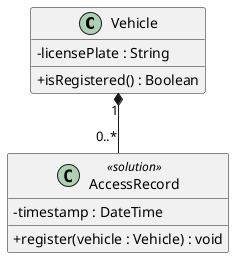

<!-- English-edition adaptation: Copyright 2026 kingle.zhuang. See NOTICE for upstream attribution. -->
# Design-class notation

Use a design class model to express significant software responsibilities, state and contracts. The conceptual domain model stays separate. This is original operational guidance informed by Fowler, *UML Distilled* (3rd ed.), chapters 1 and 3; Rosenberg & Stephens (2007), chapters 8–9; and Rosenberg, Stephens & Collins-Cope (2005).

## Detail appropriate to design

| Concern | Conceptual domain model | Design class model |
|---|---|---|
| Purpose | Business concepts and relationships. | Software responsibilities and implementation contracts. |
| Operations | Omitted in this skill's conceptual profile. | Significant operations and complete modeled signatures. |
| Types and visibility | Omitted in strict conceptual mode. | Shown when needed for an implementable contract. |
| Navigation and infrastructure | Omitted as implementation concerns. | Shown where justified; technical classes marked `<<solution>>`. |
| Multiplicity | Evidence-driven conceptual constraint. | Explicit where needed for ownership, validation or header interpretation. |

Fowler's third edition distinguishes conceptual and software perspectives; avoid importing a first-edition three-perspective description as if it were the same edition.

## Properties and operations

Use `visibility name : Type [multiplicity] = default {constraint}` for a property and `visibility operation(direction name : Type, ...) : ReturnType` for an operation. UML supplies notation; the selected profile determines which details the review needs.

- Prefer an attribute for a scalar/value property and an association for a significant relationship. Avoid showing the same relationship twice without a reason.
- Include significant operations rather than every generated accessor or private helper. Retain an accessor when its contract or nontrivial behavior matters.
- Type each parameter individually and distinguish a classifier's Operation contract from a language Method implementing it.
- Record technical/internal state from architecture, configuration and framework/interface contracts under [provenance-rules.md](provenance-rules.md).

A derived property uses `/name`, such as `/total : Money`. [OMG UML 2.5.1](https://www.omg.org/spec/UML/2.5.1/PDF) §9.5.3 and §9.9.17 define derivability; this does not select persistence, caching or materialization, prohibit indexes/keys, or imply read-only access. Preserve the derivation constraint when values change. An operation may better express a live calculation when that matches the intended API.

## Relationships

Show evidenced multiplicities and state uncertainty rather than guessing a default of `1`. Missing multiplicity is particularly important when a generated field could otherwise be either a reference or collection.

Shared aggregation has weak context-dependent meaning. Fowler discourages it; the MKL profile permits `o--` where a stated whole/part convention is useful. Prefer an ordinary association if that expresses the needed relationship clearly. Record the chosen convention.

Composition (`*--`) has stronger ownership semantics. UML 2.5.1 §9.5.3 permits a part in at most one composite at a time. Deletion of a composite deletes the object parts still attached; prior detachment may be permitted. The notation does not impose one immutable owner throughout a part's life, a specific creation order or every implementation lifecycle detail.

Generalization (`<|--`) requires substitutable instances under the intended abstraction. Similar names, shared fields or an incidental role are insufficient. Treat multiple/dynamic classification as an explicit modeling decision with an implementation explanation rather than an automatic subclass design.

Use `interface` and realization (`..|>`) for an implemented contract; use `{abstract}`/abstract classes for non-instantiable abstractions. Visibility markers are `+`, `-`, `#`, `~`; document any material mapping to the target language. `{readOnly}` expresses an update constraint, independently of derivability.

## Readability

Show the properties, operations and dependencies needed to assess the selected design. Explain a concrete responsibility or constraint instead of drawing every dependency. Layout should expose the structure and preserve legible names. Check behavior alongside structure; a tidy class diagram alone cannot demonstrate correct collaboration.

## PlantUML contract

Keep operations visible. Mark justified solution-space classes and leave ordinary problem classes unmarked. Preserve `MC-XX` and the established filename `modelo_clases_diseno.puml` when those identifiers already exist. This small example demonstrates notation only; domain ownership must come from the actual supplied evidence.
